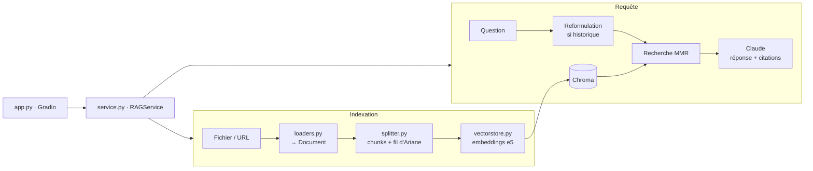

# 📚 RAG Doc Assistant

Assistant qui **répond à vos questions** et **résume** n'importe quelle documentation technique (PDF, Word, PowerPoint, Excel, pages web, Markdown, code…), avec des **réponses sourcées** et une interface Gradio.

Né d'un besoin personnel : avoir la documentation de mes librairies (pandas, python-docx…) à portée de main pour retrouver une syntaxe, en posant la question en français sur une doc écrite en anglais.


## Fonctionnalités

- **Questions/réponses ancrées** dans vos documents, avec citations numérotées `[1]` et affichage des passages utilisés
- **Exemple de code d'abord** pour les questions de syntaxe
- **Questions de suivi** (« et pour la somme ? ») grâce à la reformulation à partir de l'historique
- **Résumé de document complet** en map-reduce, quelle que soit sa taille
- **Multilingue** : question en français, documentation en anglais
- **Multi-format** : PDF, DOCX, PPTX, XLSX, CSV, HTML, URL, Markdown, TXT, JSON, code (Python, JS/TS, Java, Go, Rust, SQL…)
- **Réindexation sans doublons** et suppression d'un document de l'index
- **Filtre par document** pour limiter la recherche à une seule source

## Architecture



L'interface ne parle qu'à `RAGService` (façade) : remplacer Gradio par une API web ne touche à aucun autre module.

| Module | Rôle |
|---|---|
| `rag/config.py` | Configuration centralisée et immuable, lue depuis `.env` |
| `rag/loaders.py` | Chargement multi-format vers `Document` (texte + métadonnées), pattern *registry* |
| `rag/splitter.py` | Découpage structurel mesuré en tokens, avec fil d'Ariane des sections |
| `rag/vectorstore.py` | Embeddings e5 et base Chroma persistante, indexation idempotente |
| `rag/chains.py` | Prompts et chaînes LCEL : réponse, reformulation, résumé map-reduce |
| `rag/service.py` | Façade : `ingest`, `ask_stream`, `summarize`, `delete` |
| `app.py` | Interface Gradio |

## Choix techniques

| Brique | Choix | Pourquoi |
|---|---|---|
| LLM | Claude (`claude-haiku-5-5`, configurable) | Rapide et économique pour répondre à partir d'un contexte fourni |
| Embeddings | `intfloat/multilingual-e5-small`, en local | Gratuit, multilingue, 512 tokens de contexte. On ne paie que la génération |
| Base vectorielle | Chroma (persistante, cosinus, HNSW) | Embarquée, sans serveur, filtrage par métadonnées |
| Orchestration | `langchain-core` (LCEL) | Composition `prompt \| llm \| parser`, streaming natif |
| Chargement | Loaders maison (`pypdf`, `python-docx`, `python-pptx`, `openpyxl`, `beautifulsoup4`) | `langchain-community` est en fin de vie ; contrôle total des métadonnées |
| Interface | Gradio 6 | Chat en streaming, upload de fichiers, démo rapide |

### Décisions de conception notables

- **Taille des chunks en tokens du modèle d'embedding**, pas en caractères. Le premier modèle testé (MiniLM) ignorait tout au-delà de 128 tokens : une grande partie de chaque chunk était invisible pour la recherche. Passage à e5 (512 tokens), chunks de 400 tokens avec 60 de chevauchement.
- **Découpage structurel** : par sections Markdown, puis paragraphes ; le code Python aux frontières `class`/`def` ; les tableurs entre deux lignes. Chaque chunk est préfixé par son fil d'Ariane (`[Group by > Aggregation]`) pour que l'embedding et le LLM sachent de quoi il parle.
- **Les blocs de code ne sont jamais nettoyés** : l'indentation est préservée de l'extraction HTML jusqu'au chunk. `MarkdownHeaderTextSplitter` de LangChain a été écarté après test car il supprimait l'indentation du code.
- **Extraction HTML adaptée à Sphinx** (docs Python) : suppression des menus et ancres, titres convertis en Markdown, blocs `<pre>` conservés tels quels.
- **Indexation idempotente** : identifiants déterministes (hash de la source et de la position) et suppression préalable des chunks d'une source réindexée.
- **Préfixes e5** `passage:` / `query:` appliqués automatiquement à l'indexation et à la recherche.
- **MMR avec `lambda_mult=0.7`** : avec 0,5, la diversité faisait entrer des passages hors sujet d'autres documents.
- **Prompt ancré** : réponse uniquement à partir des extraits, « je ne sais pas » si absent, citations obligatoires, contenu documentaire délimité et traité comme donnée (protection contre l'injection de prompt).
- **Le résumé n'utilise pas la recherche** : un résumé concerne tout le document, donc tous les chunks sont parcourus en map-reduce récursif, avec appels parallèles.

## Installation

Prérequis : Python 3.11+, une clé API Anthropic ([platform.claude.com](https://platform.claude.com)).

```bash
git clone https://github.com/aagadaz/rag-docs.git
cd rag-docs
python -m venv .venv
source .venv/bin/activate        # Windows : .venv\Scripts\Activate.ps1
pip install -r requirements.txt
cp .env.example .env             # Windows : copy .env.example .env
```

Renseignez `ANTHROPIC_API_KEY` dans `.env`. Au premier lancement, le modèle d'embedding (~470 Mo) est téléchargé depuis Hugging Face.

## Utilisation

```bash
python app.py
```

Ouvrez l'adresse affichée (par défaut http://127.0.0.1:7860), ajoutez des fichiers ou des URLs, cliquez sur **Indexer**, puis posez vos questions. Choisissez un document dans la liste pour limiter la recherche ou en obtenir un résumé.

## Tests

```bash
python -m pytest -q
```

39 tests, exécutés sans clé API ni téléchargement de modèle grâce à l'injection de dépendances (faux embeddings, faux LLM, comptage en caractères) :

- loaders : tous les formats, encodages Windows, titres HTML, indentation du code, cas d'erreur ;
- splitter : taille des chunks, fil d'Ariane, blocs de code intacts ;
- vectorstore : absence de doublons, réindexation d'un document raccourci, suppression, persistance ;
- service : streaming, reformulation des questions de suivi, résumé map-reduce, format d'historique Gradio 6.

## Limites connues

- **PDF scannés** : pas d'OCR, le document est refusé avec un message explicite.
- **PDF multi-colonnes** : l'ordre de lecture extrait par `pypdf` peut mélanger les colonnes.
- **Longs blocs de code** : une section qui dépasse 400 tokens peut être coupée au milieu d'un bloc.
- **Générateurs de doc** : l'extraction HTML est optimisée pour Sphinx ; MkDocs ou Docusaurus peuvent laisser un peu de bruit (sélecteurs configurables dans `NOISE_SELECTORS`).
- **Scores de similarité e5** : resserrés (≈ 0,8–0,9), seul l'ordre est significatif ; pas de seuil de pertinence fixe.

## Pistes d'amélioration

- Recherche hybride **BM25 + vecteurs** pour les identifiants exacts (`extract_text`, codes d'erreur)
- **Reranking** des passages par un cross-encoder
- Indexation d'un **site de documentation complet** via son sitemap
- **OCR** (Tesseract) pour les PDF scannés
- Évaluation automatique de la qualité des réponses sur un jeu de questions de référence
- Intégration continue avec GitHub Actions

## Historique

Une première version (`legacy/`) reposait sur sentence-transformers, FAISS et Ollama en local. Cette v1 est une refonte modulaire et testée : chargement multi-format avec métadonnées, découpage structurel en tokens, indexation idempotente, citations et résumé.
